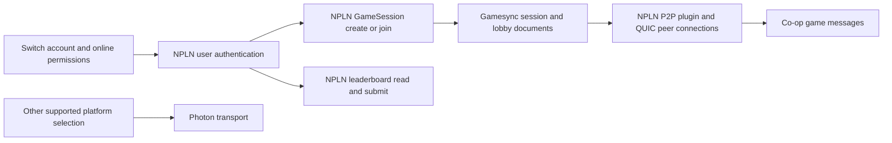

# PlateUp! Switch online flow — 2026-10-12

## Finding

In the locally installed **1.5.2**, content version **1572864**, NPLN and
Photon are alternative platform transports. Switch selects NPLN for
lobbies and Gamesync, then establishes **QUIC peer connections through
NPLN's P2P plugin**. NPLN also supplies the Switch leaderboard operations.
There is no NPLN-to-Photon handoff in this build's selected network path.

The lobby/QUIC selection is static executable/call-path evidence. A Switch
attempt subsequently confirmed tenant `t-a8f1d737-lp1` and an NPLN Auth POST
at 17:30:06 UTC. The exact subsequent RPC sequence, session schema and NAT
traversal acceptance remain unobserved; working gameplay is not yet claimed.

## Platform selection

The native `PlatformSettings` initializer sets the Switch build flag and
clears the PC, other console and platform-override flags. `get_BuildType`
therefore returns **6**, and `get_CurrentPlatformType` falls through to it.
`get_UseNPLNNetworking` returns true exactly for type 6.
`get_UsePhotonNetworking` returns false for that type (it also excludes the
signalling transport). This is stronger than the mere presence of both SDKs.

Virtual addresses in the decompressed updated `main` (module base zero):

| Evidence | Address | Interpretation |
| --- | --- | --- |
| `PlatformSettings` static initializer | `0x6306b90` | Switch flag set, overrides cleared |
| `get_BuildType` | `0x6305430` | Switch flag produces type 6 |
| `get_CurrentPlatformType` | `0x62fd010` | No override: uses build type |
| `get_UseNPLNNetworking` | `0x6305a50` | Type 6 enables NPLN |
| `get_UsePhotonNetworking` | `0x6305890` | Type 6 excludes Photon |

## Lobby and session transport

| Native entry | Address | Calls observed in its implementation |
| --- | --- | --- |
| NPLN create-lobby state machine | `0x7f61410` | Obtain user context; construct MatchmakingClient, UserDefinition and CreateGameSessionRequest; call CreateGameSessionAsync; construct NPLNLobby |
| NPLN join-lobby state machine | `0x7f61f60` | Obtain user context; call JoinGameSessionAsync; obtain Gamesync document path; read DocumentReference.GetAsync and a string value; construct NPLNLobby |
| NPLNLobby.EstablishQUIC | `0x7f5bad0` | Construct QUIC settings/transport parameters and QuicConnectionP2pPlugin; obtain Gamesync user/game session IDs; call EstablishP2pSessionAsync |
| NPLNNetworkService constructor | `0x7f5fdf0` | Initializes matchmaking config to DefaultMatchmakingConfig |
| Switch score-submission state machine | `0x6be3ac0` | Construct LeaderboardClient/LeaderboardReference; submit SetScoreAsync |
| Switch score-reading state machine | `0x6be15a0` | Wait for authentication; read user/range leaderboards and score/rank data |

The logical dependency graph is:



This diagram is a dependency map, not a captured timestamped RPC sequence.
The QUIC peer transport means the initial work is a compatibility backend
and NAT/relay setup, not a dedicated server that simulates the restaurant.

## Why the public Photon statement differs

In June 2025, the publisher's community representative stated that Photon
was used for console multiplayer in an [outage discussion](https://www.reddit.com/r/PlateUp/comments/1l9u7vp/cant_connect_to_photon/).
That historical statement cannot establish the active Switch transport in
this later local build. The binary selects NPLN; the date or update in which
that changed has not been established.

[Photon's connection documentation](https://doc.photonengine.com/realtime/v5/connection-and-authentication/regions)
describes its own Name Server → regional Master → room Game Server flow.
Those are Photon roles, not stages that follow a Nintendo NPLN lobby.
The [NPLN protocol research](https://github.com/kinnay/NintendoClients/wiki/NPLN-Servers)
documents its gRPC services and tenant metadata, but does not list PlateUp!'s
tenant.

## Evidence handling and next checks

Inputs and analysis output stay in the workspace scratch directory
`scratch/switch-multiplayer-sweep-20261012/01003F901A83E000/`, outside this
repository. Method names were mapped from IL2CPP metadata version 27 to
native code-generation module pointers after applying relative relocations.
Only these independently written conclusions are included here.

Reproduce the named calls with the original input files outside the repo:

```sh
python tools/il2cpp-method-map.py /path/to/main.bin /path/to/global-metadata.dat \
  --assembly NPLNService.dll \
  --filter 'EstablishQUIC|<CreateNewLobby>|<JoinLobby>' --calls
```

The mapper applies module-relative relocations in memory. `--calls` requires
Capstone; name/address mapping itself uses only Python's standard library.

## Server validation

The full `go test ./...` suite and `go build ./cmd/nplnd` pass. A local smoke
run refused startup with the tenant missing, then served the `plateup` health
response on 21129 and trusted TLS with HTTP/2 ALPN on 21128 and 24560 using
temporary credentials and an explicit **test-only** tenant. The smoke process
was stopped and the temporary credentials removed. That initial test preceded
the hardware capture and deployment below.

## Switch capture and deployment, 17:30–17:32 UTC

- At 17:29:56, nx-baas recorded PlateUp!'s Switch presence. At 17:30:05,
  aauth recorded application `01003f901a83e000`, version `00180000` (1572864).
- At 17:30:06, TLS SNI was
  `t-a8f1d737-lp1.lp1.t.npln.srv.nintendo.net`, ALPN `grpc-exp,h2`. The same
  attempt posted an NPLN Auth request to that hostname. It fell through to
  nx-baas, which logged an unhandled request and returned HTTP 404. The owner
  reported `2321-5760`. Traffic reached ingress, but not an NPLN title host.
- At 17:32:40, `openpak-plateup` was deployed with an exact Traefik SNI
  passthrough route, a title-specific OpenPak-CA leaf, a separate signing-key
  state volume and published Gamesync TCP 24560. The host firewall allowance
  is persisted. No other title was restarted.
- The arm64 build uses isolated source at
  `ed41a6ea7b6e3e8e8336134ad897262badddd798` plus only the PlateUp! title and
  registry entry. All tests pass. Binary SHA-256:
  `52e7c571c7fdad015e7289829c8af8f240894111ea36feaf3ad899563b063d82`.
- Public probes on 443 and direct 24560 verify the trusted TLS chain/hostname
  and `GameSessionService/ListLatencyMeasurementServers`: both return
  `tenants/t-a8f1d737-lp1/` resources and `npln-grpc-type: Unary`.
- Private deployment state, routing backup and guarded rollback are under
  `~/openpak/experiments/plateup-20261012/` on production. Rollback removes
  only this title's service, route and added firewall rule, retaining state.

Harbor-only testing is the owner's current instruction. The development
binary initially launched contained another investigation's unconditional
magenta-clear graphics probe. A clean existing Harbor build (`wt3-user`)
renders the console lock screen correctly; the diagnostic source was left
untouched. This graphics issue is separate from the Switch server capture.

## Hardware host flow, 17:34:52–55 UTC

The fresh Switch attempt reached the dedicated PlateUp! container:

1. `Auth/IssuePrearrangedUserToken` succeeded, then `QueryGameSessions` returned
   an empty session list.
2. `CreateGameSessionCreationTicket` created a lobby advertising direct
   Gamesync TCP 24560. `TrackGameSessionCreationTicket` reached `SUCCEEDED`.
3. The client connected to that port with SNI `gamesync.npln.nintendo.net`,
   called `Gamesync/IssueToken`, opened `KeepUserSession`, subscribed to session
   documents and called `WriteDocuments`.

No RPC error or unimplemented service appeared in this inspected host window.
These logs establish authentication, successful session creation and active
Gamesync document transport. They do not establish second-device joining or
QUIC gameplay. No additional title option was needed for the observed host flow.

## Switch hosting and Harbor joining, 17:35 UTC

The owner confirmed: “it works and harbor can connect to it as well.” At
17:35:36 UTC a second account authenticated and called `JoinGameSession` into
the Switch-created session. At 17:35:37 both participants requested ICE
allocation. No RPC error or unimplemented service appeared in the inspected
host/join window. This confirms Switch online entry/hosting and Harbor joining.

The project-wide result is recorded in the workspace `ledger.md`. Sustained
restaurant gameplay, reverse hosting, leave/rejoin and reconnect have not been
separately verified. LeaderboardService remains unimplemented.
LeaderboardService is an established separate feature missing from the
initial profile. Maintenance is still a linked-SDK lead, not a measured call.
